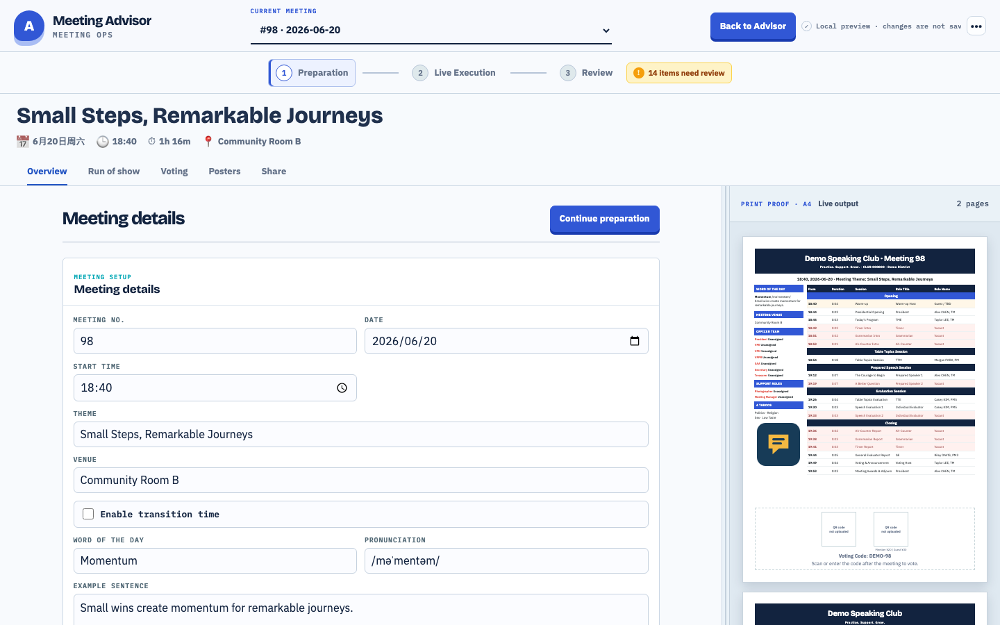
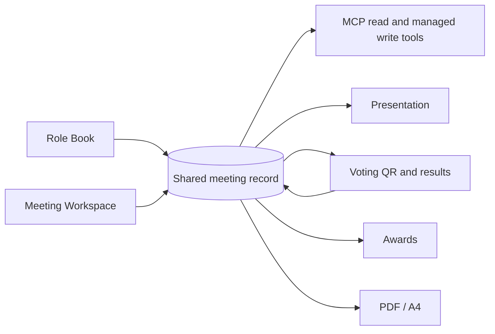

# Club Meeting Ops

Update the Agenda once. Meeting materials stay in sync.

Club Meeting Ops keeps role booking, meeting preparation, Agenda,
Presentation, Voting, Awards, and PDF on one meeting record. Each deployment
can keep the club's familiar Agenda structure, logo, colors, and layout, so the
Office Team does not repeat the same change across pages, tables, and files.

This is an independent open-source project. It is not affiliated with or
endorsed by any speaking-club organization or employer.

[中文说明](README.zh-CN.md) · [Preview locally](#preview-in-five-minutes) · [Configure your club](#configure-your-club)

## See the product



Meeting Workspace shows the editable Agenda and finished A4 pages together.
Role Book gives members a focused place to reserve roles. Presentation,
Voting, Awards, and PDF read the same meeting data.



## Preview in five minutes

Requirements: Node.js 22+ and npm.

```bash
npm ci --ignore-scripts
npm run dev
```

Open the printed URL with `?preview=1`, usually:

```text
http://localhost:5173/?preview=1
```

Preview mode uses fictional data, skips sign-in, and performs no Base writes.

## Capabilities

- Book future meeting roles against personal goals.
- Edit meeting details, Agenda blocks, roles, speeches, and learning paths.
- Reuse club-specific Agenda templates and public branding.
- Render two-page A4 agenda and live presentation views.
- Run the room from Presentation: timer signals, seasonal themes, a phone remote, a digital whiteboard, Table Topics draws, and Word of the Day cards.
- Prepare voting, confirm awards, and present certificates live inside Presentation.
- Switch a meeting to speech contest mode, with off-agenda roles and contest awards.
- Review role booking history and past meetings in Role Book.
- Review meeting readiness, risks, and post-meeting quality.
- Read meeting state through MCP; manage Draft Agenda edits, role bookings, Table Topics, and Word of the Day with explicit authorization, confirmation, audit, and revision checks.

## Agent skills

`skills/` holds instructions that teach an agent how to use this app's MCP
tools safely. They contain no credentials or club data, and they only work
with an agent that is connected to your deployment's MCP server.

| Skill | Use it to |
| --- | --- |
| `agenda-editor` | Edit one meeting's Agenda through `vpe_change_agenda`, confirm risky changes, and read the result back. |
| `role-booking` | Query and manage role bookings, member goals, speech details, and booking history. |
| `meeting-manager` | Help a Meeting Manager run one meeting from the Role Book MM SOP: today's tasks, the dated timeline, and a calendar (.ics) export. |
| `member-growth` | Track one member's Pathways progress and plan their next meeting, role, and project. |
| `vpe-planning` | Plan the next several meetings with the VPE: theme and format, guest, Sharing lead, and Meeting Manager rotation. |

1. Connect your agent to `https://<your-domain>/api/mcp` with an MCP token
   (Bearer) or the OAuth flow your client supports.
2. Install the skills with the [`skills`](https://github.com/vercel-labs/skills)
   CLI. It installs into the current project; add `-g` for every project, and
   `-a <agent>` to target one agent such as `claude-code`. Replace `<owner>`
   with the GitHub owner of this repository or your fork.

   ```bash
   npx skills add <owner>/club-meeting-ops                       # pick from the list
   npx skills add <owner>/club-meeting-ops --skill vpe-planning  # one skill
   ```

   Or copy the folders by hand, for example into Claude Code's skills folder:

   ```bash
   git clone --depth 1 https://github.com/<owner>/club-meeting-ops.git
   mkdir -p ~/.claude/skills && cp -R club-meeting-ops/skills/* ~/.claude/skills/
   ```

   For a client without skill folders, paste the `SKILL.md` you need into its
   project instructions.

3. Update the skills when this repository changes them. Use the same route you
   installed with:

   ```bash
   npx skills update                 # every installed skill; add -g for global ones
   npx skills update member-growth   # one skill
   ```

   If you copied the folders by hand, clone again and copy them over the old
   ones. If you pasted a `SKILL.md` into project instructions, paste the new
   version. A skill can mention a tool that this repository's server does not
   ship yet, such as `vpe_get_member_growth_plan` or
   `vpe_get_member_period_review` in `member-growth`. Updating your deployment
   does not add those tools; until a later server release does, the agent says
   the feature is unavailable.

Skills never authorize writes on their own. Agenda and booking writes still
need an explicit command in the conversation and the server-side write flags
described in [Security](#security).

## Architecture

```text
Browser
  │ same-origin /api
  ▼
Node.js functions ── server-only credentials ── Feishu/Lark Base
  │
  ├─ Meetings / Blocks / Items / Members
  ├─ Templates / RoleCatalog / Assets / recommendation state
  └─ separate Voting Base
```

The browser bundle never receives Base credentials. Each club deploys its own
instance, Base, session secret, and passcodes.

## Configure your club

Edit [`club-profile.js`](club-profile.js). It contains only public instance
information: club name, number, district, tagline, original logo, website,
agenda footer, award name, public MCP URL, and introduction copy.

Do not put credentials or member data in this file.

## Full local stack

1. Create your own Feishu/Lark app and an empty Base.
2. Review [`docs/BASE_SCHEMA.md`](docs/BASE_SCHEMA.md).
3. Copy `.env.example` to `.env.local`.
4. Fill required variables using only your own test resources.
5. Generate passcode hashes:

```bash
node -e 'const c=require("node:crypto"),s=c.randomBytes(16).toString("hex");process.stdout.write("scrypt$"+s+"$"+c.scryptSync(process.argv[1],s,32).toString("hex")+"\n")' 'choose-a-passcode'
```

Run it separately for `AGENDA_EDIT_PASSCODE_HASH` and
`BOOKING_PASSCODE_HASH`.

6. Generate `AGENDA_SESSION_SECRET`:

```bash
node -e 'console.log(require("node:crypto").randomBytes(32).toString("hex"))'
```

7. Check credentials without printing their values:

```bash
set -a
. ./.env.local
set +a
python3 scripts/diagnose-env.py
```

8. Start:

```bash
npm run dev
```

9. Verify:

```text
http://localhost:5173/api/health
```

`persistence: "bitable-ready"` means required Base variables are present.

## Base schema and demo data

[`docs/demo-data.json`](docs/demo-data.json) contains only fictional examples.
Do not import a production roster or meeting export.

The schema helper is dry-run by default:

```bash
python3 scripts/create-bitable-tables.py
python3 scripts/create-bitable-tables.py --apply
```

`--apply` changes the Base selected by your environment. Review the target
first. Existing installations may add `--items-only` or `--optimize-lookups`.

## Voting Base

Use a separate Base for voting responses and set
`BITABLE_VOTING_APP_TOKEN`. Pool provisioning is also dry-run by default:

```bash
npm run provision:voting-pool
npm run provision:voting-pool -- --apply
```

Never share a voting Base between unrelated clubs.

## Integration test

```bash
npm run test:integration
```

This command creates, updates, and removes temporary records. Run it only
against a dedicated test Base, never production.

## Deploy to Vercel

1. Fork this repository.
2. Import the fork as a new Vercel project.
3. Keep the Vite defaults: build `npm run build`, output `dist`.
4. Add `.env.example` variables to the server environment. Set
   `PUBLIC_APP_ORIGIN` to the deployment's public HTTPS origin, with no path.
5. Use a new Base and new secrets for this deployment.
6. Deploy and verify `/api/health`.

MCP write tools stay off until `MCP_AGENDA_WRITE_ENABLED` or
`MCP_BOOKING_WRITE_ENABLED` is exactly `true` and the `MCP Agenda Changes`
audit table exists. The Presentation remote needs a Supabase project
(`VITE_SUPABASE_URL`, `VITE_SUPABASE_PUBLISHABLE_KEY`); without it the rest of
Presentation works and the remote stays hidden.

Preview deployments should use isolated test resources or no persistence.
Never inject production secrets into fork pull requests.

## Validation

```bash
npm ci --ignore-scripts
npm run check:public
npm test
npm run build
npm audit --omit=dev --audit-level=high
git diff --check
```

Pull requests, pushes to `main`, and `v*` tags run the same quality and safety
gates. Integration tests are intentionally excluded from untrusted CI.

## Security

- `.env*`, `.vercel/`, private data, artifacts, and temporary output are ignored.
- `scripts/check-public-safety.mjs` rejects credentials, personal paths,
  identifiers, restricted instance names, and unreviewed media.
- GitHub Actions use read-only permissions and immutable action SHAs.
- Report vulnerabilities through GitHub private vulnerability reporting.

See [SECURITY.md](SECURITY.md), [CONTRIBUTING.md](CONTRIBUTING.md),
[PUBLIC_FILES.md](PUBLIC_FILES.md), and
[THIRD_PARTY_NOTICES.md](THIRD_PARTY_NOTICES.md).

## License

MIT. See [LICENSE](LICENSE).
